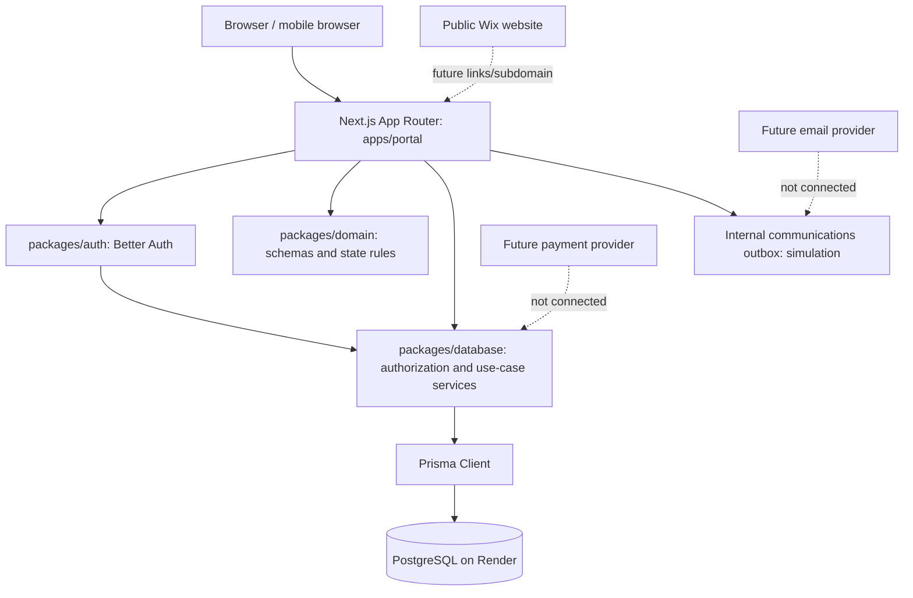
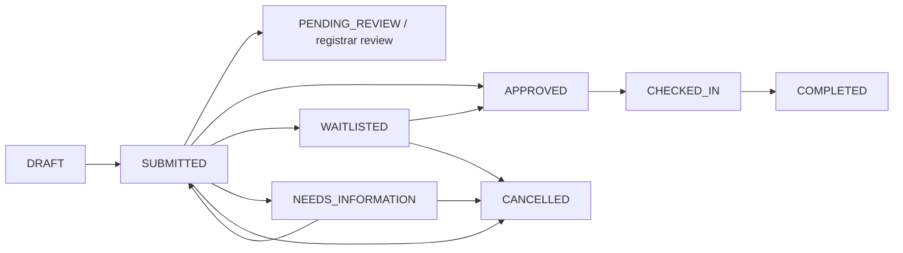

# Technical architecture and developer reference

**Project:** Faith Adventures Camp Portal  
**Repository:** [LeviKempNLS/Camp_Portal](https://github.com/LeviKempNLS/Camp_Portal)  
**Documentation baseline:** `main` at `70672e82f0cf8e19cb095f78b8fd88ed898e652d` (October 30, 2026).  
**Status:** working development/demo application, **not approved for real camper, medical, or payment data**.

This reference documents the implemented source structure and operational flows. For planned work see [roadmap #18](https://github.com/LeviKempNLS/Camp_Portal/issues/18). Exact behavior is ultimately defined by code, migrations and tests; recheck this guide after implementation changes.

## 1. System at a glance

Faith Adventures Camp Portal is a **Wix-independent modular monolith**. One Next.js application presents the parent, registrar, director, counselor and medical experiences. Application logic is separated into local npm workspace packages. The application uses PostgreSQL for operational persistence, with Prisma for schema, migrations and database access.



There is **no deployed microservice mesh, external payment checkout, or live transactional email service** in the documented baseline. The communications outbox persists recipient snapshots but only simulates delivery. The internal finance ledger *is* implemented and supports offline funding.

## 2. Technology inventory

| Layer | Implemented technology | Reference |
| --- | --- | --- |
| Language | TypeScript 5.9 | `apps/portal/package.json` and workspace manifests |
| Runtime / package management | Node.js 22+; npm workspaces (root declares npm 11.6.2) | root `package.json` |
| Web app and server | Next.js 16.1, App Router, React 19.2 | `apps/portal/` |
| Rendering / forms | React Server Components, client registration wizard, server actions and Next route handlers | `apps/portal/app/`, `apps/portal/components/` |
| Authentication | Better Auth 1.4; PostgreSQL-backed sessions and accounts | `packages/auth/` |
| Database | PostgreSQL 16+; Prisma ORM and Prisma Client 6.16 | `packages/database/prisma/` |
| Authorization | DB-backed roles/permissions plus household and staff-assignment scoping | `packages/database/src/portal.ts`, operations modules |
| Core domain | Vendor-neutral TypeScript domain functions and JSON-versioned form schema | `packages/domain/src/` |
| Test framework | Node built-in test runner, database integration tests, Playwright browser E2E | package scripts, `tests/e2e/` |
| Quality checks | ESLint 9, TypeScript, Prettier 3.6 | package scripts |
| Hosting | Render Node Web Service and PostgreSQL, separate from Wix | `docs/operations/deployment.md` |

Version ranges above are declared dependency ranges, not a guarantee about the exact installed transitive versions. Consult `package-lock.json` for resolution.

## 3. Repository map

```text
Camp_Portal/
├── README.md                       Start here
├── package.json                    Workspace orchestration; build/test/bootstrap scripts
├── package-lock.json               Locked dependency graph
├── .env.example                    Configuration placeholders (no live secrets)
├── playwright.config.ts            Desktop/mobile browser test setup
├── apps/
│   └── portal/
│       ├── app/                    App Router pages, API handlers, server actions
│       │   ├── api/                Health, auth, registration, exports
│       │   ├── admin/              Registrar and operational workspaces
│       │   ├── dashboard/          Role-sensitive landing page
│       │   ├── household/          Household and person management
│       │   ├── registrations/      Camper/session selection and registration
│       │   ├── staff/              Assignment-scoped staff view
│       │   ├── medical/            Permissioned medical view
│       │   └── lib/access.ts       Authenticated current/required portal user
│       ├── components/             Shared UI, including registration-wizard
│       └── lib/                    Draft-save coordination, timezone/session helpers
├── packages/
│   ├── auth/src/                   Better Auth server/client config, demo registrar command
│   ├── domain/src/                 Form definitions, validation, registration state machine
│   └── database/
│       ├── prisma/schema.prisma    Entities, enums, relations, indexes
│       ├── prisma/migrations/      Versioned migrations
│       ├── prisma/seed.ts          Fictitious demo fixtures
│       └── src/                    Camp use-case/query modules and integration tests
├── tests/e2e/                      Playwright browser scenarios
└── docs/                           ADRs, architecture, security, workflows and guides
```

### Database service entry points

`packages/database/package.json` exposes these subpaths, intentionally separating use cases:

| Module | Responsibility |
| --- | --- |
| `./src/index.ts` | Prisma client access and shared database entry point |
| `./src/portal.ts` | Profile/household/registration access, permissions and common errors |
| `./src/invitations.ts` | Secure additional-adult household invitations |
| `./src/admin.ts` | Seasons, sessions, registration windows and capacity configuration |
| `./src/registration-operations.ts` | Draft write and registration submit/review transitions with capacity enforcement |
| `./src/operations.ts` | Groups, cabins, role-bearing staff assignments |
| `./src/roster.ts` | Safe camper rosters, placements, T-shirt counts and CSV |
| `./src/finance.ts` | Append-only financial ledger, scholarships, churches, balances |
| `./src/attendance.ts` | Check-in/check-out and attendance status |
| `./src/medical.ts` | Narrow, audited medical projection with special authorization |
| `./src/reports.ts` | Registrar reports and privacy-safe exports |
| `./src/communications.ts` | Audience selection, recipient snapshots and simulated outbox |

Prefer importing the specific subpath over bypassing services with direct Prisma queries in UI code. Some existing pages use Prisma for read-side session discovery; business mutations should remain in server-side use cases.

## 4. Request and module interaction

### Authentication and permissions

1. The browser authenticates via Better Auth in `packages/auth`; auth tables include `User`, `Account`, `AuthSession`, and `Verification`.
2. Server pages and route handlers call `currentPortalUser` or `requirePortalUser` from `apps/portal/app/lib/access.ts`.
3. The portal ensures the authenticated user has an appropriate person/profile link where applicable.
4. DB use-case functions check authorization **again**, not merely navigation visibility. Guardians require household ownership/portal access. Administrative actions require named permissions. Staff roster access is scoped to active session/group/cabin assignments.
5. The query returns a **minimal projection** for the role. A staff or roster page does not receive raw medical, financial or emergency-contact details.

Role assignments are additive: a guardian can also be staff without losing household access. Staff-created role provenance is tracked to prevent removal of independently granted roles.

### Registration lifecycle



Diagram illustrates major documented transitions; the authoritative permitted edges are enforced by `packages/domain/src/index.ts` and `packages/database/src/registration-operations.ts`.

1. Parent selects a household camper and an eligible open season/session at `/registrations/new`.
2. The UI loads the draft (if any), combines confirmed household defaults with saved answers, and renders `components/registration-wizard.tsx`.
3. `DraftSaveCoordinator` serializes browser save requests; the route `/api/registrations/draft` authenticates and delegates to `saveOwnedDraftSafely`. **Drafts persist in PostgreSQL**, not merely in browser storage.
4. Submission through `/api/registrations/submit` validates form answers, household ownership, session/window and capacity. A transaction/locking strategy protects capacity and waitlisting under concurrency.
5. Registrar reviews through `/admin` and `/admin/registrations/[registrationId]`. Submitted entries are read-only to parents unless information is requested.
6. `registration-operations` integrates with `finance` to create the base charge as a ledger record on submission; payment completion is **not** a registration prerequisite.

### Camp placement, attendance, reporting

- `admin` configures season and session rules.
- `operations` configures groups/cabins and staff assignments in a session.
- `roster` validates same-session placement and capacity; registrar views use a limited projection; counselor/group-director views are scoped by assignment.
- `attendance` allows approved registration → check-in → check-out/completion with audit and timestamps; its dashboard does not load medical or finance data.
- `medical` exposes only explicitly permitted care information to properly authorized staff.
- `reports` creates limited operational/contact CSV outputs, excludes restricted data and mitigates spreadsheet formula injection.

### Finance and communications

The finance subsystem is **implemented without a gateway**. `FinancialEntry` stores types `CHARGE`, `PAYMENT`, `SCHOLARSHIP_CREDIT`, `CHURCH_COMMITMENT`, `CHURCH_PAYMENT`, `ADJUSTMENT`, `REFUND`, and `REVERSAL`. Entries are not edited in place; a correction is represented by a new entry/reversal. `sourceKey` provides an idempotency path for a future provider. `finance.read` and `finance.record` are separate permissions. Household receipts, sponsorship commitments and cash paid by churches are separately represented; an unpaid balance does not block registration.

Communications stores `OutboxMessage` with a selected audience (`ALL_HOUSEHOLDS`, `SESSION`, `REGISTRATION_STATUS`, `STAFF`), recipient snapshot and `QUEUED`/`SIMULATED_SENT`/`CANCELLED` status. **Simulate sent does not send email.** External delivery/retry/receipts are backlog #23 and #27.

## 5. Data model and persistence patterns

Source of truth: `packages/database/prisma/schema.prisma`; apply changes only through reviewed migrations.

- **Identity and access:** `User`, `Account`, `AuthSession`, `Verification`, `Role`, `Permission`, `RolePermission`, `UserRole`.
- **Families:** `Person`, `Household`, `HouseholdMember`, `CamperProfile`, `PortalInvitation`.
- **Camp setup:** `Organization` → `Season` → `Session` → `CampGroup` and `Cabin`; `StaffAssignment` joins Person and Session with optional placement scope.
- **Registration/forms:** `Registration` joins one camper, household, session; `FormDefinition`, `FormVersion`, `FormSubmission`, structured emergency contacts.
- **Operations:** `CamperPlacement` (one current placement per registration, session-safe composite relationships); `CampAttendance`.
- **Money:** `Church`, `ScholarshipProgram`, `FinancialEntry`.
- **Communication/audit:** `OutboxMessage` and recipient records; `AuditEvent`.

The design combines **normalized relational ownership** with **JSONB for versioned answers/settings and audit context**. Composite foreign keys and unique constraints make cross-session placements invalid even if a caller bypasses UI validation. Prices and ledger amounts are PostgreSQL `Decimal(10,2)`, not floating-point money. Audit and financial history are append-oriented, whereas current assignments/registration state represent present operational state.

## 6. Patterns and architectural decisions

| Pattern | Where / reason |
| --- | --- |
| Modular monolith / workspace packages | Single deployable app, clear auth/domain/data boundaries without distributed-system overhead |
| Server-side use-case/service layer | Mutations centralized in database modules, not scattered across components |
| Role-based and resource-scoped authorization | Both named permission and *which* household/session/assignment can be accessed |
| State machine | Explicit valid registration transitions and status-dependent UI |
| Transactional invariants and row locking | Capacity, waitlist, cabin assignment and finance consistency under concurrency |
| Versioned forms | Answers tied to a form version so historical registrations remain interpretable |
| Append-only ledger and audit | Financial corrections and operational events retain traceability |
| Idempotency | Repeated submissions, demo fixtures and future provider ingestion should not duplicate entries |
| Server-rendered data, client-side interactive wizard | Secure data reads alongside responsive draft editing |
| Narrow read models / least privilege | Roster, staff, reports and medical surfaces receive only the fields needed |
| Adapter boundary (planned) | Payment/email integrations must not become the system of record |

## 7. Local development and testing

Prerequisites: Node 22+, npm from the root package declaration, PostgreSQL 16+.

```bash
cp .env.example .env
npm ci
npm run prisma:generate
npm run db:migrate:dev
npm run db:seed                # fictitious DEVELOPMENT data only
npm run dev
```

Use a local PostgreSQL `DATABASE_URL` and appropriate Better Auth configuration (`BETTER_AUTH_SECRET`, `BETTER_AUTH_URL`). Never use actual personal details in development or commit secrets.

```bash
npm run lint
npm run typecheck
npm test
npm run test:integration       # requires configured test PostgreSQL
npm run test:e2e              # Playwright Chromium
npm run test:e2e:all          # desktop + mobile Chromium
npm run build
npm run format:check
```

Root `test:integration` invokes the current collection of database integration test files and migrations. `playwright.config.ts` uses local dev server and `/api/health` when `PLAYWRIGHT_BASE_URL` is not set; browser failures retain traces/screenshots/videos. Run database destructive tests against an isolated disposable database only.

## 8. Deployment and operational caveats

The documented **development/demo** Render configuration builds with `npm ci && npm run build`, starts with `npm run start`, and serves health at `GET /api/health`. After issue #19's first safety change, root `start` launches Next.js without migrations or demo seeding. `db:bootstrap:demo` remains an **explicit**, demo-only operation that runs migrations, fictitious seed and demo registrar provisioning; `start:demo` invokes that bootstrap before startup. Never use these demo commands with real data. Production migrations need a separate controlled release step; backup/restore, credential review, monitoring and security sign-off remain outstanding under #19.

`BETTER_AUTH_URL` must represent the actual public portal origin. Secrets belong in Render secret/environment settings, not code or output. Render free tier is appropriate to the demo, not a production readiness guarantee. See `docs/operations/deployment.md` for the existing deployment recipe.

The existing deployment document records security advisory concerns and incomplete account verification/password reset. Before launch verify dependencies/security, backup restoration, recovery, privacy notices, retention, access scopes and incident handling (#19–#22).

## 9. Extending modules safely

1. Find the owning domain/use-case module and relevant ADR; avoid putting financial or medical data in a general roster response.
2. Add schema changes and Prisma migration; preserve existing data, uniqueness and session scope.
3. Add server-side permission and ownership checks to the owning use case.
4. Expose a narrowly scoped server action or `app/api` handler; validate untrusted input and do not trust client-provided identifiers.
5. Keep UI visibility consistent with permissions but never rely on it alone.
6. Add unit, integration and Playwright coverage, especially negative authorization and race cases.
7. Ensure financial transactions create entries/reversals, not destructive updates; avoid duplicate provider events.
8. Update this guide, the [user guide](../USER_GUIDE.md), README and the roadmap issue.

## 10. Source index / further reading

- [Architecture overview](architecture/overview.md)
- [Domain model](data-model/domain-model.md)
- [Authorization](security/authorization.md)
- [Registration workflow](workflows/registration.md)
- [Payments design notes](workflows/payments.md)
- [Render deployment](operations/deployment.md)
- [Authentication ADR](adr/0002-authentication.md)
- [User guide](USER_GUIDE.md)
- [Completion backlog](https://github.com/LeviKempNLS/Camp_Portal/issues/18)

**Document boundary:** This is a code-informed reference, not an assertion that production controls, external providers, every test, or complete workflow sign-off have been verified.
