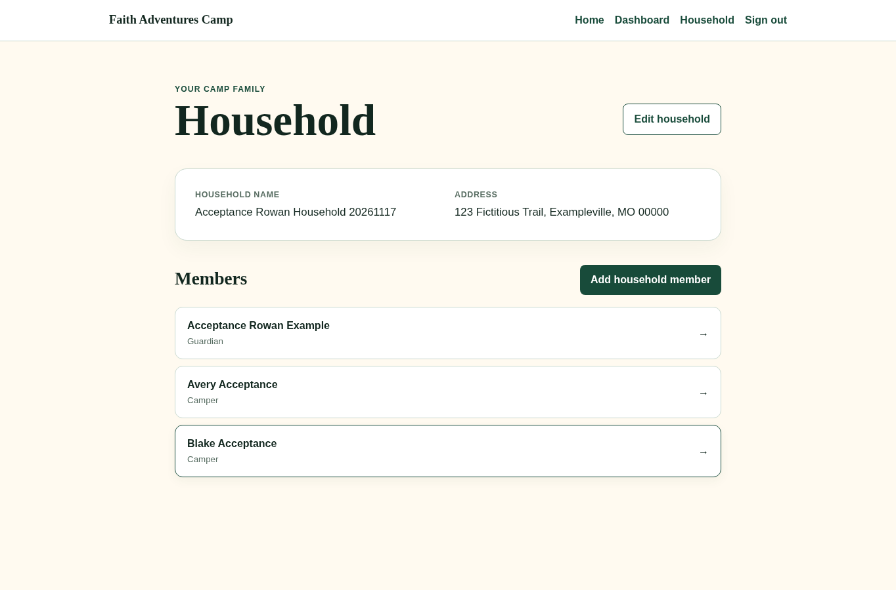
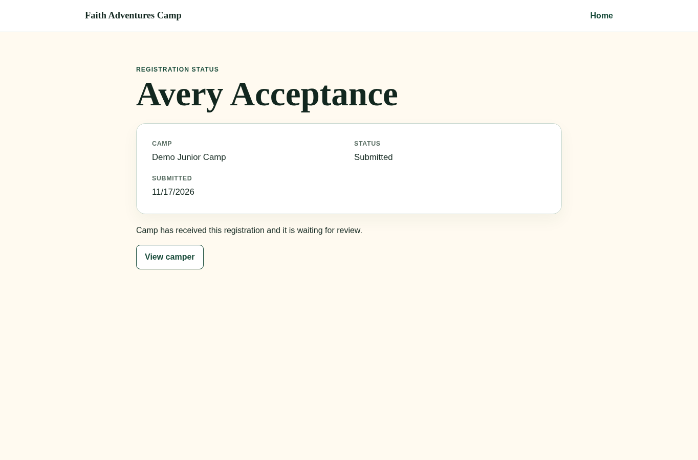
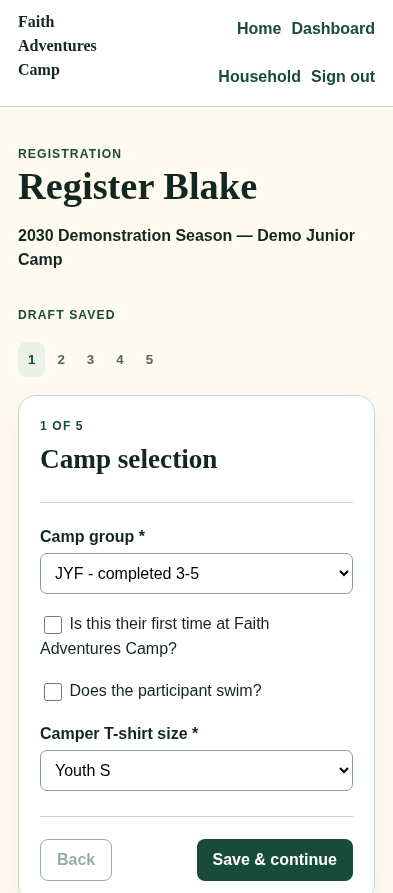

# Live acceptance — November 17, 2026

The user authorized agent-managed fictitious credentials and test identity provisioning. Authentication is no longer waiting for user action. Credentials are kept outside the repository in a permission-restricted local file and excluded from evidence/screenshots.

| Parent acceptance scenario | Status | Expected | Actual evidence |
| --- | --- | --- | --- |
| Signup/authentication | PASS | New fictitious account signs in | Browser signup reached dashboard; parent-dashboard.png |
| Household creation/edit | PASS | Own household created and editable | Automatic household created; name/address saved with confirmation |
| Two campers | PASS | Separate profiles | Avery Acceptance and Blake Acceptance created; parent-two-campers.png |
| Household/camper persistence | PASS | Records remain after reload/sign-in | Reload and reauthentication retained household, address and both profiles |
| Registration for each camper | PASS | Per-camper/session wizard | Separate drafts started for Demo Junior Camp |
| Draft autosave | PASS | Answers save after debounce | Saved group/shirt sizes survived full reload |
| Reload/resume | PASS | Same draft restored | Both camper drafts reopened with saved answers |
| Draft independence | PASS | Camper A does not overwrite B | Avery Youth M, Blake Youth S; isolation read returned Youth M for Avery |
| Final navigation flush | FAIL | Immediate navigation retains final edit | Adult S reverted to Youth M; defect #33; draft-results.json |
| Submission/validation | PASS | Required fields enforced; no payment prerequisite | Missing fields returned to guardian section; completed Avery form submitted with no online payment |
| Status visibility/read-only | PASS | Submitted status visible and locked | Submitted status persisted; no submit button; submitted-status.png |
| Sign-out/protected denial | PASS | Logged-out account cannot access household | /household redirected to /sign-in |
| Sign-in persistence | PASS | Household, status and second draft retained | Reauthenticated using same test account; all remained |
| Guardian admin denial | PASS | No staff/admin escalation from signup | /admin, /staff, /medical, /admin/finance returned 404; exports 403 |
| Mobile parent workflow | PASS | Usable form and persistent mobile edits | 393px draft had no horizontal overflow; phone edit survived reload; mobile-parent-draft.png |
| Cross-household privacy | PASS | Second parent cannot access first household records | Camper pages 404; draft GET returned null (no disclosure); PATCH returned 403 for both campers |

Evidence: draft-results.json, submission-results.json, parent-security-results.json. Existing showcase data was not seeded, reset or overwritten. Existing five demo sessions were visible to the new parent, but showcase household/ledger counts remain unverified.

Agent-created registrar, counselor and medical identities authenticate successfully; their privileged roles are not assigned. Positive-role tests remain BLOCKED by the lack of a privileged execution path: the web service is free (no Render SSH shell), hosted Render SQL is read-only and additionally blocked by the database allowlist, and connected tools expose no server command execution. No role bypass was added. This is a technical access limitation, not a request for manual credential entry or a refusal to create demo accounts.

Fix for [#33](https://github.com/LeviKempNLS/Camp_Portal/issues/33) is implemented on feature branch `fix/33-flush-registration-drafts`: queue the latest edited answers on leaving; avoid autosaving untouched snapshots; use keepalive for final payloads within the browser budget. The deterministic browser regression fails on the original source (old shirt size remains) and passes with the fix. All 10 desktop/mobile E2E tests, 40 isolated PostgreSQL integration tests, lint, TypeScript, unit tests and production build passed locally on lockfile dependencies. This does not change the deployed FAIL result; the fix is not merged/deployed.

Baseline: `97f4d45cf009641becb67fd5d9476d0c44ffe5e3`; live Render deployment `dep-dbu6v6u7bikc739pe670`. [Main CI](https://github.com/LeviKempNLS/Camp_Portal/actions/runs/44112264441) passed separately from these live results. Roadmap: #18; acceptance: #21.

Public homepage/sign-up/sign-in, health (`200`, database connected), anonymous protected-page denial and anonymous API/export denial passed. Public mobile pages had no horizontal overflow.

## Browser evidence

## Remaining release gates

Positive registrar/staff/medical/finance scenarios, capacities/waitlists, camp placements, CSV content, scholarships/church payments/offline receipts, ledger history, attendance, reports and outbox remain BLOCKED until privileged demo-role provisioning can execute. Normal parent account signup does not grant these roles. Agent-created test identities are ready for assignment; no manual password entry is needed.

Data survival across a fresh restart/deployment remains BLOCKED: this run did not restart or redeploy the live app. Source/config inspection confirms normal startup does not migrate/seed/promote; it is not a runtime persistence certification. Existing showcase sessions are visible, but household/camper/ledger preservation is not signed off.

Infrastructure findings tracked in #19: Render HTTP healthCheckPath is empty despite a working /api/health; the free PostgreSQL instance expires November 29, 2026. Backups and isolated restore must be demonstrated. No real records may be introduced before #19–#22 release gates pass.

No existing demonstration records were deliberately changed, reset or deleted. Changes to live data are limited to agent-created fictitious test accounts, their households/campers/drafts and one submitted registration. No deployment/merge or production migration was performed.
